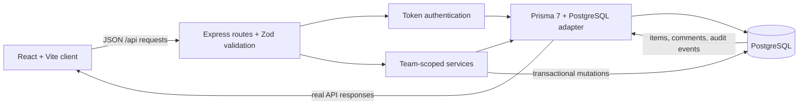

# Newtonite — Operations Under Pressure

A team-scoped work queue for incident and operations work. The React client talks to an Express API; PostgreSQL is the source of truth for accounts, memberships, work items, idempotency records, and immutable activity history.

## Architecture



The browser owns presentation and draft state only. Membership checks, role decisions, workflow transitions, optimistic-version checks, idempotency, and audit writes are enforced server-side. Queue filters and cursor pagination run in PostgreSQL; dashboard summaries describe loaded, filtered results rather than implying team-wide totals. The development seed includes four teams, ten accounts, 3,000 deterministic work items, and two named examples for review.

## Requirements

- Node.js 22.12 or newer
- PostgreSQL 15 or newer, with permission to install the built-in `pg_trgm` extension in the application database
- npm 10 or newer

## Run from a fresh checkout

1. Create an application database and a separate test database. For a local PostgreSQL installation, connect as a database administrator and run:

   ```sql
   CREATE ROLE newtonite_app LOGIN PASSWORD 'choose-a-local-password';
   CREATE DATABASE newtonite OWNER newtonite_app;
   CREATE DATABASE newtonite_test OWNER newtonite_app;
   ```

   Use a URL-encoded password if it contains URL-reserved characters. The migration creates `pg_trgm` and its text-search indexes.

2. Install dependencies and configure local environment values:

   ```powershell
   npm ci
   Copy-Item .env.example .env
   ```

   Edit `.env`: set both database URLs, replace `AUTH_SECRET` with at least 32 random characters, and set `SEED_PASSWORD` to a password of at least 12 characters. To generate an auth secret in PowerShell:

   ```powershell
   node -e "process.stdout.write(require('node:crypto').randomBytes(48).toString('base64url'))"
   ```

   Keep `.env` private; it is ignored by Git. The seed refuses to run when `NODE_ENV=production`.

3. Generate the client, apply the migration, and seed development accounts:

   ```powershell
   npm run db:generate
   npm run db:migrate
   npm run db:seed
   ```

   The seed is development-only and idempotent. It creates four teams, ten demo users, 3,000 deterministic records, and two named Operations examples. Re-running it will not duplicate seeded work items and will not overwrite their existing work-item state.

4. Start the API and Vite development server:

   ```powershell
   npm run dev
   ```

   Open the Vite URL printed by the dev server (normally `http://localhost:5173`). The Vite server proxies `/api` to the Express API on port 3000. `npm run build` generates Prisma Client from the schema, type-checks the project, and creates the production client bundle; `npm start` starts the API and serves that bundle when `dist/` exists.

   If port 3000 is already in use, set `PORT` in `.env` to a free port; Vite reads the same value for its API proxy.

   If the default Vite port is also occupied, start the services on alternate ports in separate terminals:

   ```powershell
   $env:PORT = "3100"
   npm run dev:api
   # In a second terminal:
   $env:PORT = "3100"
   npm run dev:web -- --host 127.0.0.1 --port 5175 --strictPort
   ```

   Open `http://localhost:5175`. Keep the API `PORT` and Vite proxy port aligned.

## Docker Compose

Docker Engine with the Compose plugin is required. Compose runs PostgreSQL 16 and the production application; PostgreSQL data persists in the `postgres-data` named volume. The database port is not published to the host. On first application startup, Prisma applies pending migrations before Express starts.

1. Create a private local environment file and generate safe random values:

   ```powershell
   Copy-Item .env.example .env
   node -e 'for (const name of ["POSTGRES_PASSWORD","AUTH_SECRET","SEED_PASSWORD"]) console.log(`${name}=${require("node:crypto").randomBytes(32).toString("hex")}`)'
   ```

   Copy the three generated assignments into `.env`. The generated hexadecimal database password is URL-safe. Keep `.env` private; Git ignores it. Docker Compose publishes the application on host port `3001`.

2. Validate the resolved configuration, build, and start the application:

   ```powershell
   docker compose config --quiet
   docker compose up --build -d
   docker compose ps
   ```

   Open `http://localhost:3001`. The app waits for the PostgreSQL health check, applies migrations, and then becomes healthy. To inspect startup or migration errors, run `docker compose logs -f app db`.

3. Seed or refresh deterministic demo data in the running database:

   ```powershell
   docker compose --profile seed run --rm seed
   ```

   This one-shot service receives `SEED_PASSWORD` and `AUTH_SECRET` but the long-running application container does not receive `SEED_PASSWORD`. The demo email addresses and roles are listed below; use the `SEED_PASSWORD` value from `.env`.

4. Stop the services while preserving the database volume:

   ```powershell
   docker compose down
   ```

   Re-run `docker compose up -d` to resume with the same database.
   To **permanently remove the database volume and all its data**, use `docker compose down -v` only after confirming that the data can be discarded.

5. To exercise the API integration suite against a separate local PostgreSQL test database, configure `TEST_DATABASE_URL` in `.env` to a database ending in `_test`, migrate it, then run:

   ```powershell
   $previousDatabaseUrl = $env:DATABASE_URL
   try {
     $env:DATABASE_URL = $env:TEST_DATABASE_URL
     npm run db:migrate
     if ($LASTEXITCODE -ne 0) { throw "Test database migration failed." }
     npm test
     if ($LASTEXITCODE -ne 0) { throw "API tests failed." }
   } finally {
     if ($null -eq $previousDatabaseUrl) {
       Remove-Item Env:DATABASE_URL -ErrorAction SilentlyContinue
     } else {
       $env:DATABASE_URL = $previousDatabaseUrl
     }
   }
   ```

## Demo accounts

All seeded accounts use the password set in `SEED_PASSWORD`. The seed creates:

| Email | Team | Role |
|---|---|---|
| `alex.rivera@newtonite.dev` | Operations | Lead |
| `blake.chen@newtonite.dev` | Operations | Member |
| `casey.morgan@newtonite.dev` | Operations | Viewer |
| `devon.patel@newtonite.dev` | Operations / Platform / Finance | Admin / Viewer / Admin |
| `erin.park@newtonite.dev` | Platform | Lead |
| `finley.shaw@newtonite.dev` | Platform | Member |
| `fabiola@newtonite.dev` | Operations | Member |
| `grace.liu@newtonite.dev` | Customer Success | Lead |
| `harper.stone@newtonite.dev` | Customer Success / Finance | Member / Member |
| `jules.martin@newtonite.dev` | Finance / Platform | Lead / Admin |

These are development fixtures, not production identities. Seeded passwords are intentionally shared only because the seed accepts one local development password; never seed a production database.

## API and authorization

All API responses use JSON. Errors have the shape `{ "error": { "code": "...", "message": "...", "details": ... } }`. Protected routes require `Authorization: Bearer <token>` from `POST /api/auth/login`. The token contains only a user ID; the server loads the active account and team membership from PostgreSQL for each request.

| Endpoint | Purpose |
|---|---|
| `GET /api/health` | Liveness check |
| `POST /api/auth/login` | Authenticate an account |
| `GET /api/auth/me` | Get the current account and its team-scoped roles |
| `GET /api/teams/:teamId/members` | List active members of an accessible team |
| `GET /api/teams/:teamId/items` | Search and filter, with `q`, `type`, `priority` (one value or comma-separated values, e.g. `P0,P1`), `status`, `assigneeId`, `limit` (1–50), and `cursor` |
| `POST /api/teams/:teamId/items` | Create a work item |
| `GET /api/teams/:teamId/items/:itemId` | Read one item and its latest 100 activity events |
| `POST /api/teams/:teamId/items/:itemId/comments` | Add an append-only comment |
| `PATCH /api/teams/:teamId/items/:itemId` | Update fields with a required `version` |
| `POST /api/teams/:teamId/items/:itemId/claim` | Atomically claim an unassigned Open item with a required `version` |

Every mutating request requires a non-empty `Idempotency-Key` header (up to 200 characters). Reusing a key with the same actor and request returns the stored HTTP status and JSON response. Reusing it for a different request returns `409 IDEMPOTENCY_KEY_REUSED`.

Example PowerShell session: sign in, discover a team ID from the authenticated account, then create and list work items. Set the same `SEED_PASSWORD` value used when seeding.

```powershell
$baseUrl = "http://localhost:3000"
$session = Invoke-RestMethod -Method Post -Uri "$baseUrl/api/auth/login" `
  -ContentType "application/json" `
  -Body (@{ email = "alex.rivera@newtonite.dev"; password = $env:SEED_PASSWORD } | ConvertTo-Json)
$headers = @{ Authorization = "Bearer $($session.token)" }
$me = Invoke-RestMethod -Uri "$baseUrl/api/auth/me" -Headers $headers
$teamId = $me.user.memberships[0].team.id

$headers["Idempotency-Key"] = [guid]::NewGuid().ToString()
$created = Invoke-RestMethod -Method Post -Uri "$baseUrl/api/teams/$teamId/items" `
  -Headers $headers -ContentType "application/json" `
  -Body (@{ title = "Review dispatch alert"; type = "INCIDENT"; priority = "P1" } | ConvertTo-Json)

Invoke-RestMethod -Uri "$baseUrl/api/teams/$teamId/items?priority=P1&limit=20" `
  -Headers @{ Authorization = "Bearer $($session.token)" }
```

Send a fresh idempotency key for each new mutation. Reuse the original key only to retry that exact request.

### Team permissions

- **Viewer:** Read team work items and team members.
- **Member:** Create items, claim unassigned Open items, and edit items they created or claimed. Members cannot assign another owner.
- **Lead:** Member access plus team-wide editing, owner assignment, and approval.
- **Admin:** Team-wide editing and owner assignment, but not approval. Membership administration is not part of this challenge.

Membership checks and role checks run on the server. Supplying a role or team ID in a body never grants access. Cross-team reads return `404` to avoid disclosing another team’s existence.

### Workflow

`OPEN → IN_PROGRESS | BLOCKED`; `IN_PROGRESS → OPEN | BLOCKED | IN_REVIEW`; `BLOCKED → IN_PROGRESS`; `IN_REVIEW → IN_PROGRESS | APPROVED`; `APPROVED → DONE`; `DONE` is terminal. Only a Lead of the item's team may move it into `APPROVED`; Admins cannot approve.

## Tests

The API suite is an integration suite and needs a migrated PostgreSQL test database. `TEST_DATABASE_URL` must point to a database whose name ends in `_test`; before each test the suite truncates its tables. It will refuse to run against another database name.

```powershell
$previousDatabaseUrl = $env:DATABASE_URL
try {
  $env:DATABASE_URL = $env:TEST_DATABASE_URL
  npm run db:migrate
  if ($LASTEXITCODE -ne 0) { throw "Test database migration failed." }
  npm test
  if ($LASTEXITCODE -ne 0) { throw "API tests failed." }
} finally {
  if ($null -eq $previousDatabaseUrl) {
    Remove-Item Env:DATABASE_URL -ErrorAction SilentlyContinue
  } else {
    $env:DATABASE_URL = $previousDatabaseUrl
  }
}
```

Tests exercise concurrent claims, concurrent duplicate creates and comments, optimistic version conflicts, idempotent replay and key reuse, comment/event transaction rollback, Lead-only approval, cross-team isolation, server-side multi-priority filtering and cursor pagination, and Viewer/Member write restrictions.

Other checks:

```powershell
npm run typecheck
npm run build
npm audit
```

## Known limitations

- Authentication uses eight-hour HMAC bearer tokens stored in browser `sessionStorage`; there is no refresh-token flow or per-token revocation. Disabling an account invalidates its tokens because the API rechecks the active account on requests. A production deployment should add a carefully configured CSP and consider an HttpOnly session-cookie design.
- Login rate limiting, account recovery, user/team administration, invitation flows, and production identity-provider integration are out of scope.
- There is no transactional outbox or background worker. Database mutations and audit writes are synchronous and transactional; retryable asynchronous side effects are deferred until there is a real consumer and delivery requirement.
- Idempotency records are retained indefinitely and keys are unique per actor. Add a retention policy before operating at large scale.
- The activity table rejects row updates and deletes with a database trigger. Database owners can still bypass application-level audit guarantees with privileged schema operations such as `TRUNCATE` or trigger changes.
- Comments and item detail currently return at most 100 records per collection; older activity and comments are not separately paginated.
- Cursor ordering is stable for an unchanged result set (`updatedAt`, then `id`); concurrent edits can move rows between pages. Refresh the list after a conflict or when a fully current view is required.
- Search is case-insensitive substring search over title and description. Trigram indexes improve ordinary multi-character queries; very short search strings may still require a scan within the selected team.
- Overview counts are intentionally limited to the currently loaded, filtered page and are labeled accordingly; they are not team-wide analytics.
- The demo seed uses one configured local password for all fixtures and is blocked in production. It generates only synthetic data. Do not use these accounts as real identities.
- The development client and API are designed to be same-origin in production; separate-origin deployments need an explicit CORS and cookie/token policy.

## Project documents

- [ENGINEERING_DECISIONS.md](./ENGINEERING_DECISIONS.md) — data integrity, transaction, authorization, and concurrency choices.
- [KNOWN_LIMITATIONS.md](./KNOWN_LIMITATIONS.md) — current scope boundaries and operational limitations.

## Submission and verification status

Docker Compose execution must be verified on a machine with Docker Engine and Compose installed. The automated API tests require a real PostgreSQL test database as described above; a Docker database may be used by publishing a local-only port in a private override file. Do not commit database URLs, passwords, or the generated `.env` file.
